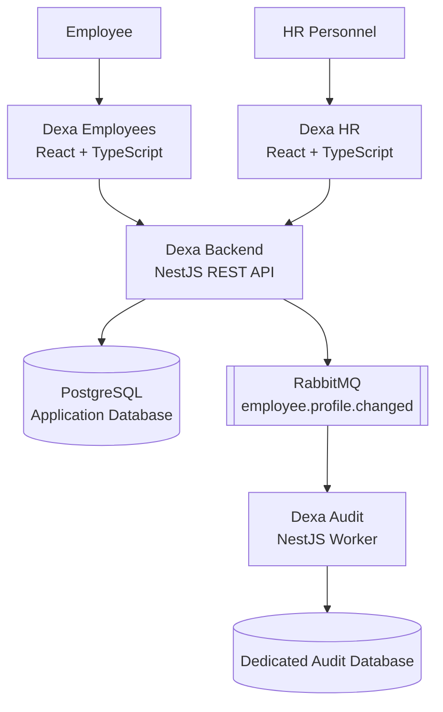

# Dexa — Employee Management & Attendance Platform

Dexa is a full-stack employee management and attendance platform designed to connect employees, HR personnel, and audit infrastructure through a modular architecture.

The project consists of four repositories: two role-specific web applications, a central backend API, and an independent audit service. Together, they demonstrate frontend development, API design, authentication and authorization, database integration, asynchronous messaging, and automated testing.

## Project Overview

Dexa provides separate interfaces for employees and HR personnel while centralizing business logic in a backend API. Employee profile changes are also communicated to an independent audit service through RabbitMQ, allowing audit records to be processed separately from the main application.

### Key Features

- **Employee portal** — employee authentication, profile management, password management, attendance actions, and attendance history and summaries.
- **HR portal** — dashboard statistics, employee management, attendance monitoring, and notifications.
- **REST API** — centralized authentication, employee and attendance operations, and role-based access control.
- **Asynchronous auditing** — RabbitMQ events connect employee profile changes to an independent audit worker.
- **Audit persistence** — audit events are stored in a dedicated database, separate from the primary application data.
- **Automated testing** — tests across the application components help validate core behavior and reduce regressions.

## Architecture

### How the Components Work Together

1. **Employees and HR access their respective portals.** Each React application provides a user interface tailored to its role.
2. **The backend handles business operations.** The NestJS API authenticates requests, enforces access permissions, and processes employee and attendance operations.
3. **Application data is persisted.** The backend uses PostgreSQL with Prisma for database access.
4. **Profile changes generate events.** The backend publishes employee profile-change events through RabbitMQ.
5. **The audit service processes events independently.** The worker consumes `employee.profile.changed` messages and stores audit records in its own database.

This separation keeps the user interfaces, core business logic, and audit processing in distinct components, making each repository easier to develop, test, and maintain independently.

## Repository Structure

| Repository | Responsibility | Technologies |
|---|---|---|
| [dexa-employees](https://github.com/AdriAntoriV2/dexa-employees) | Employee-facing web application | React, TypeScript, Vite |
| [dexa-hr](https://github.com/AdriAntoriV2/dexa-hr) | HR dashboard and workforce management | React, TypeScript, Vite |
| [dexa-backend](https://github.com/AdriAntoriV2/dexa-backend) | REST API, authentication, business logic, and event publishing | NestJS, TypeScript, PostgreSQL, Prisma |
| [dexa-audit](https://github.com/AdriAntoriV2/dexa-audit) | Asynchronous audit-event processing and persistence | NestJS, TypeScript, RabbitMQ, PostgreSQL |

## Technology Stack

### Frontend

- React 19
- TypeScript
- Vite
- React Router
- Lucide React
- Vitest and React Testing Library

### Backend

- NestJS
- TypeScript
- PostgreSQL
- Prisma ORM
- JSON Web Token (JWT) authentication
- Role-based access control (RBAC)
- Swagger API documentation
- Vitest and Supertest

### Messaging and Audit

- RabbitMQ
- Event-driven processing
- Independent audit worker
- Dedicated audit database

## Engineering Highlights

### Separation of Responsibilities

Each repository has a focused responsibility: employee experience, HR operations, core API services, or audit processing. This modular design allows components to evolve without requiring the entire system to be developed as a single application.

### Authentication and Authorization

The backend provides authentication and role-based authorization, while the frontend applications enforce role-specific access to their respective interfaces. The backend remains responsible for enforcing permissions on protected operations.

### Event-Driven Architecture

RabbitMQ decouples profile-change event publishing from audit processing. The audit worker handles events independently, with message-processing behavior designed to account for duplicate event IDs and database failures.

### API Documentation and Testing

The backend provides Swagger documentation for exploring API endpoints. Automated tests across the project help verify application behavior and support maintainable development.

## Getting Started

Dexa is split across four repositories, so each component has its own dependencies and configuration.

1. Clone the repository you want to explore from the links above.
2. Follow its README for installation, environment variables, and startup instructions.
3. Configure the backend database and required services.
4. Start the backend API and the required messaging infrastructure.
5. Start the employee or HR frontend and configure its API base URL.
6. Start the audit worker and configure RabbitMQ and its audit database if you want to run the complete event-processing flow.

The backend API and messaging infrastructure must be available for features that depend on them. Environment variables, credentials, and deployment-specific values should be configured locally rather than committed to source control.

## Project Goals

Dexa was built to explore and demonstrate practical full-stack engineering concepts, including:

- Building responsive, role-specific React applications.
- Designing REST APIs with authentication and authorization.
- Integrating relational databases through an ORM.
- Communicating between independent services using message queues.
- Separating audit processing from core business operations.
- Writing automated tests and maintaining code quality across multiple repositories.

## Project Links

- **[Dexa Backend](https://github.com/AdriAntoriV2/dexa-backend)** — central API and business logic.
- **[Dexa Employees](https://github.com/AdriAntoriV2/dexa-employees)** — employee-facing portal.
- **[Dexa HR](https://github.com/AdriAntoriV2/dexa-hr)** — HR management portal.
- **[Dexa Audit](https://github.com/AdriAntoriV2/dexa-audit)** — asynchronous audit service.

---

*Dexa is a portfolio project demonstrating a modular full-stack application with role-based interfaces, a centralized backend, and event-driven audit processing.*