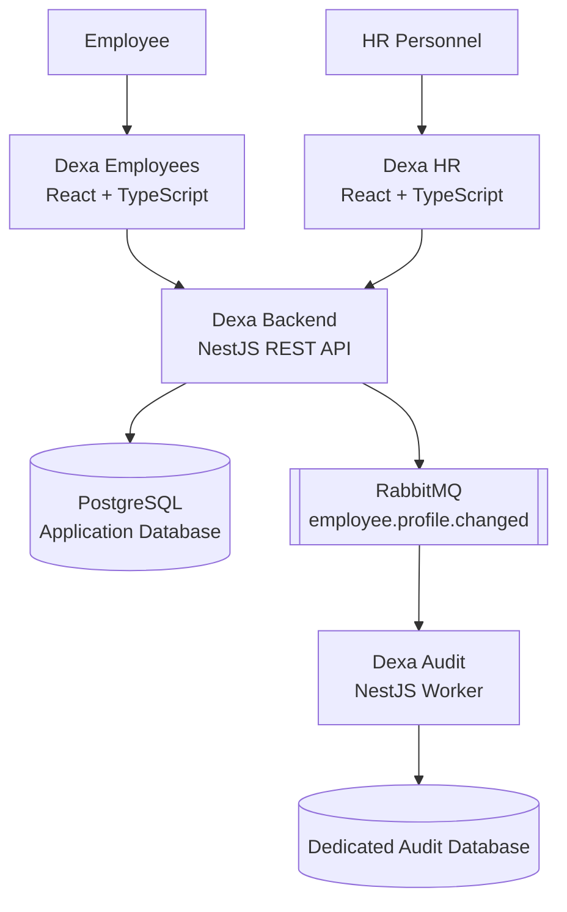

# Dexa — Employee Management & Attendance Platform

Dexa is a full-stack employee management and attendance platform designed to connect employees, HR personnel, and audit infrastructure through a modular architecture.

The project consists of four repositories: two role-specific web applications, a central backend API, and an independent audit service. Together, they demonstrate frontend development, API design, authentication and authorization, database integration, asynchronous messaging, and automated testing.

## Project Overview

Dexa provides separate interfaces for employees and HR personnel while centralizing business logic in a backend API. Employee profile changes can also be communicated to an independent audit service through RabbitMQ, allowing audit records to be processed separately from the main application.

### Key Features

- **Employee portal** — authentication, profile management, password management, attendance actions, and attendance history and summaries.
- **HR portal** — dashboard statistics, employee management, attendance monitoring, and notifications.
- **REST API** — centralized authentication, employee and attendance operations, and role-based access control.
- **Asynchronous auditing** — RabbitMQ events connect employee profile changes to an independent audit worker.
- **Audit persistence** — audit events are stored in a dedicated database, separate from the primary application data.
- **Automated testing** — tests across the application components help validate core behavior and reduce regressions.

## Architecture



### How the Components Work Together

1. **Employees and HR access their respective portals.** Each React application provides a user interface tailored to its role.
2. **The backend handles business operations.** The NestJS API authenticates requests, enforces access permissions, and processes employee and attendance operations.
3. **Application data is persisted.** The backend uses PostgreSQL with Prisma for database access.
4. **Profile changes generate events.** The backend publishes employee profile-change events through RabbitMQ.
5. **The audit service processes events independently.** The worker consumes messages and stores audit records in its own database.

## Repository Structure

| Repository | Responsibility | Technologies |
|---|---|---|
| [dexa-employees](https://github.com/AdriAntoriV2/dexa-employees) | Employee-facing web application | React, TypeScript, Vite |
| [dexa-hr](https://github.com/AdriAntoriV2/dexa-hr) | HR dashboard and workforce management | React, TypeScript, Vite |
| [dexa-backend](https://github.com/AdriAntoriV2/dexa-backend) | REST API, authentication, business logic, and event publishing | NestJS, TypeScript, PostgreSQL, Prisma |
| [dexa-audit](https://github.com/AdriAntoriV2/dexa-audit) | Asynchronous audit-event processing and persistence | NestJS, TypeScript, RabbitMQ, PostgreSQL |

## Technology Stack

### Frontend

- React 19
- TypeScript
- Vite
- React Router
- Lucide React
- Vitest and React Testing Library

### Backend

- NestJS
- TypeScript
- PostgreSQL
- Prisma ORM
- JSON Web Token (JWT) authentication
- Role-based access control (RBAC)
- Swagger API documentation
- Vitest and Supertest

### Messaging and Audit

- RabbitMQ
- Event-driven processing
- Independent audit worker
- Dedicated audit database

## Getting Started

The `dexa-project` repository provides Windows batch scripts to install and run all four applications from one directory.

### Prerequisites

Install the following before starting:

- **Windows** — the supplied `.bat` scripts are designed for Windows.
- **Git** — to clone the four application repositories.
- **Node.js 24.x** — the installation script checks for Node.js major version 24.
- **npm** — included with Node.js.
- **Environment configuration** — valid credentials and connection strings for the application database, audit database, RabbitMQ, and frontend API configuration.

The database and messaging services must be reachable using the configured environment variables. The scripts do not provision hosted databases or RabbitMQ instances.

### 1. Prepare the Project Directory

Clone this orchestration repository, or place the provided project files in a directory named `dexa-project`.

The expected directory structure before installation is:

```text
dexa-project/
├── env/
│   ├── .env-backend
│   ├── .env-audit
│   ├── .env-employees
│   └── .env-hr
├── install-dexa.bat
├── run-dexa.bat
├── README.md
└── .gitignore
```

The `env` directory contains the environment files used by the installer. Make sure each file contains the configuration required by its corresponding application.

Do not commit real credentials, API keys, tokens, or database connection strings to Git.

### 2. Install All Applications

Open Command Prompt in the `dexa-project` directory and execute:

```bat
install-dexa.bat
```

The installation script automates the following steps:

1. Checks the required tools and Node.js version.
2. Clones the four application repositories into the project directory, reusing existing clones when available.
3. Copies each environment file into its corresponding repository as `.env`, preserving the original files inside `env`.
4. Installs dependencies using the available lockfile when possible.
5. Generates the Prisma client for the backend.
6. Starts the backend API, audit worker, and both frontend applications.
7. Opens the employee and HR portals in the browser.

The installer expects these repositories:

- [Dexa Backend](https://github.com/AdriAntoriV2/dexa-backend)
- [Dexa Audit](https://github.com/AdriAntoriV2/dexa-audit)
- [Dexa Employees](https://github.com/AdriAntoriV2/dexa-employees)
- [Dexa HR](https://github.com/AdriAntoriV2/dexa-hr)

If a repository already exists, the script reuses it rather than cloning it again. Existing `.env` files are preserved by the installer, so update them manually when configuration changes are required.

### 3. Access the Applications

Once the services have started, use the following local URLs:

| Component | URL |
|---|---|
| Employee portal | [http://localhost:5173](http://localhost:5173) |
| HR portal | [http://localhost:5174](http://localhost:5174) |
| Backend API | [http://localhost:3000](http://localhost:3000) |
| Swagger API documentation | [http://localhost:3000/docs](http://localhost:3000/docs) |

The audit service runs as a background worker and does not provide a frontend page.

The employee and HR portals depend on the backend API. Audit processing also requires a valid RabbitMQ connection and the audit database configuration.

### 4. Run the Applications Again

After the initial installation, use:

```bat
run-dexa.bat
```

This script starts the existing backend, audit worker, employee portal, and HR portal.

Unlike `install-dexa.bat`, the run script does not clone repositories, install dependencies, copy environment files, or regenerate the Prisma client.

Before using it, make sure the initial installation has completed successfully and each repository has its required `.env` file and installed dependencies.

### 5. Updating Configuration

Environment files are stored in the root `env` directory:

| File | Application |
|---|---|
| `env/.env-backend` | Backend API |
| `env/.env-audit` | Audit worker |
| `env/.env-employees` | Employee portal |
| `env/.env-hr` | HR portal |

The installer copies these files into the corresponding repositories as `.env` files. Editing the files in `env` does not automatically update the copies already present inside each repository. After changing configuration, update the corresponding application's `.env` file as well.

Restart the affected application after changing environment variables.

### Troubleshooting

- **Node.js version check fails:** Install Node.js 24.x and reopen Command Prompt.
- **A repository fails to clone:** Verify Git is installed and the GitHub repositories are accessible.
- **An application cannot connect to the database:** Check the corresponding `.env` file and confirm the database connection string is valid.
- **The frontend cannot reach the API:** Verify the backend is running and the frontend API URL is configured correctly.
- **Swagger does not load:** Check that the backend started successfully and is listening on port `3000`.
- **Notifications or audit events do not appear:** Verify RabbitMQ connectivity and the audit worker's configuration.
- **A dependency or Prisma error occurs:** Review the terminal output for the failing application and rerun the installation after resolving the underlying issue.

## Engineering Highlights

### Separation of Responsibilities

Each repository has a focused responsibility: employee experience, HR operations, core API services, or audit processing. This modular design allows components to evolve without requiring the entire system to be developed as a single application.

### Authentication and Authorization

The backend provides authentication and role-based authorization, while the frontend applications enforce role-specific access to their respective interfaces. The backend remains responsible for enforcing permissions on protected operations.

### Event-Driven Architecture

RabbitMQ decouples profile-change event publishing from audit processing. The audit worker handles events independently, with message-processing behavior designed to account for duplicate event IDs and database failures.

### API Documentation and Testing

The backend provides Swagger documentation for exploring API endpoints. Automated tests across the project help verify application behavior and support maintainable development.

## Project Goals

Dexa was built to explore and demonstrate practical full-stack engineering concepts, including:

- Building responsive, role-specific React applications.
- Designing REST APIs with authentication and authorization.
- Integrating relational databases through an ORM.
- Communicating between independent services using message queues.
- Separating audit processing from core business operations.
- Writing automated tests and maintaining code quality across multiple repositories.

## Project Links

- **[Dexa Backend](https://github.com/AdriAntoriV2/dexa-backend)** — central API and business logic.
- **[Dexa Employees](https://github.com/AdriAntoriV2/dexa-employees)** — employee-facing portal.
- **[Dexa HR](https://github.com/AdriAntoriV2/dexa-hr)** — HR management portal.
- **[Dexa Audit](https://github.com/AdriAntoriV2/dexa-audit)** — asynchronous audit service.

---

*Dexa is a portfolio project demonstrating a modular full-stack application with role-based interfaces, a centralized backend, and event-driven audit processing.*